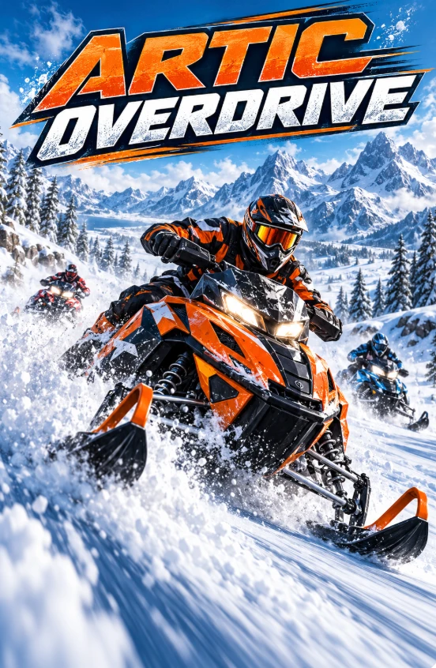

<p align="center"></p>

# Arctic Overdrive

Browser snowmobile game — Three.js + Rapier + Vite + TypeScript.

```bash
npm install
npm run dev      # http://localhost:5173
npm run build    # typecheck + production build
```

## Controls
| Action | Keyboard | Gamepad |
|---|---|---|
| Throttle / brake (hold brake when stopped = reverse) | W / S | RT / LT |
| Steer (in the air: spin) | A / D | Left stick |
| Rider lean side / fore-aft (in the air: roll / flip) | Arrow keys | Right stick |
| Pop: hold to preload, release to jump | Space | A |
| Tricks: Superman / Heel Clicker / Seat Grab / Cliffhanger | J / K / L / I | X / Y / B / RB |
| Can-Can / Nac-Nac | J or K + A/D | X or Y + stick |
| Hitch / unhitch trailer (Freeride) | H | D-pad left |
| Cycle trailer test load | G | D-pad right |
| Camera (chase / far / hood) | C | Back |
| Recover (Time Trial: back to last checkpoint) | R | LB |
| Pause (resume, restart, settings, quit) | Esc / P | Start |
| Freeride: time of day / weather | T / Y | D-pad up / R3 |
| Freeride: day/night cycle on/off | N | |
| Freeride: photo mode / replay | F / V | D-pad down / L3 |

The cover art (`src/assets/cover.webp`) is the loading and title screen; Settings (graphics, time of day,
day/night cycle, camera, controls) opens from the title, the mode menu and the pause card (`src/ui/Settings.ts`).

### Modes
- **Freeride** – the open valley. 24 hidden frost crystals (light beams show when you're close),
  6 scenic viewpoints, 3 trick spots (×2 combo points), trailer test (H/G), time of day and weather
  (clear / snowing / blizzard), photo mode (drag/WASD orbit, wheel/QE zoom, ZX lens, P saves a PNG)
  and a 25 s cinematic replay with trackside, orbit and heli shots plus slow-mo in the air.
- **Time Trial** – three checkpoint courses across groomed, powder, ice, slush, crust and moguls.
  3-2-1 countdown, split deltas against your best, a ghost of your best run, bronze/silver/gold,
  top-5 personal bests, wrong-way warning and a rewards breakdown. Ghosts are stored in localStorage.

- **Delivery** – a job board of runs between the trailhead depot and the valley's cabins
  (`src/data/deliveries.json`). Light jobs ride on the rear rack (their mass is added to the sled);
  heavy jobs use the trailer and need a tow hitch. Fragile cargo loses value on hard landings
  and crashes can shed rack cargo; roll up slowly next to spilled items to reload them. Pay scales
  with what arrives and its condition, plus a capped time bonus; late deliveries pay half.
- **Snocross** – six-rider races at Frostpine Arena (`src/world/SnocrossTrack.ts`): banked berms
  from the track's curvature, a tabletop, a double, rhythm rollers and whoops inside snow-bank walls.
  Five events, one per tier (`src/data/snocross.json`); the AI rides the event's sled with the same
  physics as you, using the RouteFollower plus lanes, traffic avoidance and marshal recovery.
  Grid start, laps, live standings, best lap and payouts by place.
- **Special Delivery** – unlocks after 2 deliveries. Four contracts (`src/data/special.json`) carry an
  unmarked package from one cabin to another while agents on snowmobiles chase you
  (`src/modes/ai/PursuitAI.ts`: lead pursuit, tree/rock/cabin and steep-snow avoidance, box-in slots
  around you, back-out and respawn when stuck). Being seen raises the wanted level (1–5 stars): more
  and faster agents, and from 3 stars a helicopter whose searchlight tracks you at a limited rate
  (`src/vehicles/Helicopter.ts`). Terrain, forest and distance break line of sight; tree cover hides
  you from the beam. Stay unseen to lose them, then they search your last known spot before giving
  up. The drop only works with nobody on your tail; stopping with an agent alongside fills the
  boxed-in meter and gets you busted. Pay is the biggest in the game, plus a bonus per star reached.

Courses live in `src/data/tracks.json` as chains of trail sections and off-trail connectors; the
terrain generator shapes those connectors (graded, tree-free corridors) automatically. Rewards are in
`src/data/modes.json`, freeride points of interest in `src/data/freeride.json`.

### Tricks
Flips (backflip / front flip) and 360s are detected from the sled's real rotation; pose tricks are held
with a trick button and score more the longer you hold them. Get the rider back in the seat before
touchdown or it's a crash. Tricks chain into a combo (×1 per trick); a clean landing keeps the combo
open for 2 s so you can chain the next jump, a sketchy landing banks 75%, a crash loses it.
Heavier setups pop lower and rotate slower (air torques are fixed, inertia comes from mass).

### Sleds, garage & progression
Five sleds, one per tier, each modelled on a real class (`src/data/sleds.json`):

| Tier | Sled | Class | Character |
|---|---|---|---|
| 1 | Nordvik Trail 600 | Entry trail (~600cc, 129in) | Light, cheap, slow; the starter |
| 2 | Ravik Crossfire 850 | Crossover (~850cc, 137in) | Balanced trail/powder |
| 3 | Altamont Summit 165 | Mountain (165in x 3in lugs) | Floats in powder, narrow and twitchy on ice |
| 4 | Kestrel SX-R 600 | Snocross race (121in) | Stiff long-travel suspension, best on jumps and tracks |
| 5 | Overdrive Turbo Build | Custom turbo | Highest ceilings, turbo kits, exclusive liveries |

A sled is bought with cash once its progress gates are met (own the tier below, XP, medals,
crystals). Parts (`src/data/parts.json`) change real physics values through one function,
`deriveParams()` in `src/vehicles/SledSpec.ts`: engine (intake/exhaust/ECU/turbo), clutch gearing,
track length, lugs, studs, shocks, springs, skis, weight, tow hitch. The garage has two tabs:
**Dealership** and **Upgrades**; Upgrades is split into Engine, Drivetrain, Track, Suspension, Skis,
Weight, Towing and Paint & Gear sections, and shows a before/after comparison of every stat before you
buy. Suspension (spring preload, compression, rebound, front/rear balance) and Drivetrain (clutch
engagement, gearing) also have free tuning sliders (`tuning` in `parts.json`). Towing needs a hitch
add-on fitted to the sled; the trailer's upgrades live in the same Towing section. A next-sled progress
bar sits at the top of the menu and garage. Saves are versioned (v2) and older saves
migrate automatically.

### Handling & snow
Tuning for the arcade feel lives in `src/data/handling.json`: suspension damping (extra rebound
damping stops the rear bucking), slip curves (skis/track grip up to a peak slip angle then slide;
throttle or braking uses up the track's grip so the rear steps out), body position (lean into a
turn for bite, counter-lean to lose it; side lean steers by itself in powder; lean forward to load
the skis, back for traction and to keep the nose up), landing assist and the bog model (snow drag
fades near standstill so a heavy rig crawls instead of stopping; wheelspin digs the track in).

Every ski, track and trailer runner stamps a persistent rut into a GPU deformation texture
(0.25 m resolution on high quality) that the terrain shader shades as real grooves. A matching
packed-snow grid feeds back into physics: riding in an existing rut sinks less.

### Deep snow
A sunk ski or track sits in its own groove, so in soft snow the sled tracks straight and turns by
carving (lean into the turn) rather than skating sideways. Turns are capped at what the snow can hold,
and a spinning track loses some side grip on hardpack (power slides). Pinning the throttle while
slow in powder makes the track dig a trench under itself until the belly pan rests on the snow:
you're bogged. Rock side to side, back out (hold S), or feather the throttle to climb out; R always recovers.
Heavy trailer loads bog much more easily than a solo sled.

### Trailer
`H` hitches the Haulmaster utility trailer (needs a tow hitch add-on) (spherical hitch joint + soft yaw/pitch/roll limits).
Cargo adds mass and raises the trailer's centre of gravity: slower acceleration, longer braking,
wider turns, deeper sinking in powder, swing-out on ice, jackknifes when braking hard while
turning, tip-overs on sidehills and bad landings (cargo spills; fragile items lose value on hard
landings and bottom-outs). Tricks are disabled while towing; small jumps still score airtime.
Upgrades are bought in Garage › Upgrades › Towing once a tow hitch is fitted (data in `src/data/trailers.json`):
heavy-duty shocks, wide powder skis, ratchet straps / cargo net.

### Graphics
Stylised alpine look: gradient sky with sun/moon and drifting clouds, a continuous 24 h lighting
script (`src/world/Sky.ts`) where the sky-derived environment map supplies most of the ambient light
(lavender shade on snow), distance haze, three rings of distant peaks, snow sparkle, fading track
marks, a gondola line, lit lamp posts and a small rail/box park (`src/world/Resort.ts`).
Presets live in `src/core/Graphics.ts` and are picked in the pause menu (the game reloads):
- **Low** — no shadows or post-processing, fewer snowflakes, no lamp lights.
- **Medium** — 1024 shadows, bloom, colour grade + vignette, speed blur, 2 lamp lights.
- **High** — soft 2048 shadows, GTAO, bloom, sun shafts, speed blur, 6 lamp lights.
On every preset the pixel ratio drops automatically (down to 60%) if frames run longer than ~19 ms.

## Layout
- `src/core` — game loop (fixed 60 Hz physics + interpolated rendering), input, camera, save
- `src/physics` — Rapier world, terrain heightfield, surface definitions
- `src/vehicles` — sled spec → derived physics params, raycast sled physics, primitive model (`SledVisual` interface for GLTF swap)
- `src/world` — noise, terrain generation (heights + surface zones), terrain mesh, scenery, jumps, sky/weather, mountains, resort, track marks, effects, snow deformation
- `src/render` — post-processing chain
- `src/modes` — GameMode interface, Freeride, TimeTrial, Snocross, Delivery, SpecialDelivery, routes, checkpoints, ghosts, replay, photo mode, `ai/RouteFollower`, `ai/RaceAI`, `ai/PursuitAI`
- `src/ui` — HUD (with minimap), title/loading screen (`Title.ts`), mode menu and pause card (`Menu.ts`), settings panel (`Settings.ts`), garage/dealership, showroom (3D garage scene), styles
- `src/core/Progression.ts` — every purchase/unlock/install rule
- `src/data` — all tunables: `surfaces.json`, `sleds.json`, `world.json` (incl. jumps), `tricks.json`, `handling.json`, `parts.json`, `trailers.json`, `cargo.json`, `deliveries.json`, `snocross.json`, `special.json`

## Debugging
- `__game.simulate(seconds, { throttle: 1, steer: 0.5 }, { jump: true })` — deterministic physics steps.
- `__dev.startTrail('loop', 'full')` then `__dev.drive(10, 50)` — autopilot along a trail (loads: none/empty/light/full), returns speed, trailer swing, cargo left and events.
- `__dev.runRoute('lake-run')` — the RouteFollower AI drives a course and reports its time (medal calibration).
